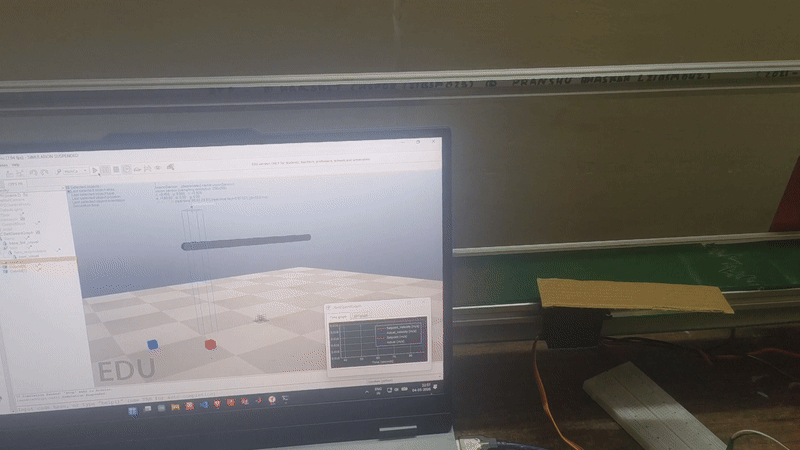
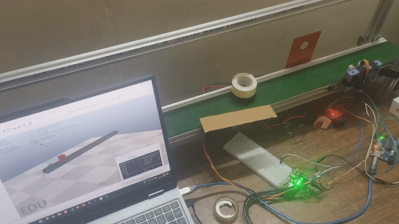
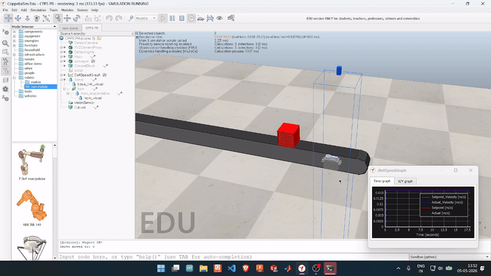
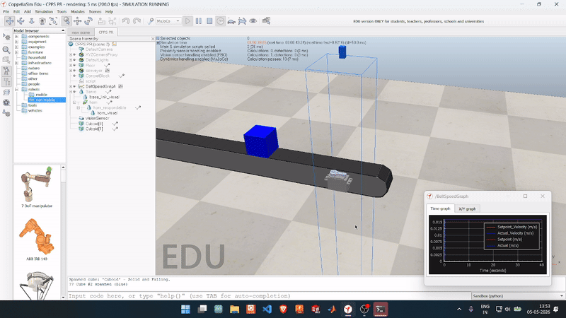

# Digital Twin of a Sorting Conveyor Belt

## Contents

- [Project overview](#project-overview)
- [Hardware and setup](#hardware-and-setup)
- [Hardware connections](#hardware-connections)
- [Challenges and reflections](#challenges-and-reflections)
- [Demo](#demo)
- [Documentation and references](#documentation-and-references)

This project was built as part of the Cyber Physical Production System (CPPS) course (SM2007) in Semester IV and was presented in May 2026 to Dr. Sunil Agrawal. The idea was to create a digital twin of a sorting conveyor system that could mirror the behaviour of a real manufacturing setup in CoppeliaSim while staying connected to physical hardware.

## Project overview and features

This digital twin focuses on a conveyor system where objects are detected, classified, and sorted using a servo-driven deflector. The system combines a physical belt, Arduino-based control, sensor feedback, and a synchronized virtual environment in CoppeliaSim.

The main idea is simple but effective:

- The CoppeliaSim model mirrors the belt motion and object movement after calibrating it to belt using encoder(AS5600) attached to shaft.
- The simulation decides when a box is red or blue.
- The servo deflector is triggered to sort red blocks.
- Start, pause, and stop commands can be controlled through the simulation interface.

This connects well with the broader vision of cyber-physical production systems and e-Kanban based material handling, where physical flow and digital information need to stay aligned.

## Hardware and setup

| Component | Purpose |
| --- | --- |
| Arduino Uno R3 clone | Main controller for sensor input and actuator control |
| AS5600 magnetic encoder | Real-time belt speed monitoring and synchronization |
| HC-SR04 ultrasonic sensor | Object detection on the conveyor |
| MG995 servo | Sorting deflector actuation |
| 25T aluminum horn | Servo motion transfer for sorting action |
| L298N motor driver | Conveyor motor control |
| CoppeliaSim + Python API | Digital twin simulation and real-time linkage |

Since a color sensor was unavailable, the red and blue boxes were differentiated in the simulation logic using a scripted rule: odd blocks were treated as red and even blocks as blue. This allowed the team to focus on the digital twin and synchronization aspect while still validating the sorting behaviour.

## Hardware connections

The circuit connections are shown in the Fritzing diagram below. The interactive design is available on Cirkit Designer.

[View circuit design on Cirkit Designer](https://app.cirkitdesigner.com/project/d9228d28-0b95-4da0-bed4-be7adbecac25)

## Challenges and reflections

Getting reliable communication between the physical hardware and the simulation was one of the main challenges. For this setup, the Arduino Uno R3 worked better with CoppeliaSim's serial API than the ESP32, but the connection was still not fully reliable.

If I were to revisit the project, I would try using Python's `pySerial` library to handle serial communication. It could provide a more direct way to manage the connection between the Arduino and the digital twin.

---

## Demo

**NOTE** :- This Demo section contains GIFs of Video Demo which might take to render in browser.

### Start, pause, and stop control

<figure align="center">
  
  <figcaption>Controlling Conveyor belt(Start and Stop of belt) using CoppeliaSim's Simulation User Interface (resume, pause, and end buttons)</figcaption>
</figure>

### Red block sorting

The red block sorting sequence was recorded both in the real setup and in the simulation so that the action can be compared side by side.

| Real-world view | CoppeliaSim view |
| --- | --- |
|  |  |

### Blue block pass-through

The blue block case shows the servo remaining in the home position while the object continues along the belt without being redirected.

| Real-world view | CoppeliaSim view |
| --- | --- |
|  |  |

## Documentation and references

- Full project report: [CPPS final report.docx.pdf](CPPS%20final%20report.docx.pdf)
- Circuit design: [Circuit diagram link](https://app.cirkitdesigner.com/project/d9228d28-0b95-4da0-bed4-be7adbecac25)
- Additional videos,report and code: [Google Drive link](https://drive.google.com/drive/folders/1oeRM1Fay_l-g0H1e3yIWCXOQP-xok18I?usp=drive_link)

Complete Arduino Code and CoppliaSim Scene are available in this repo. For Complete Simulation and Real World Demo Vidoes along with  Arduino Code and CoppliaSim Scene file please check the above drive link.
